<!-- TITANIUM OS / MINIMAL — generated SVG art; edit config.json then run python scripts/render_cards.py -->

<a href="https://madilportfolio.vercel.app/">Portfolio</a> &nbsp; / &nbsp; <a href="https://github.com/TitaniumFeather">GitHub</a>

<!-- To customize each project's link, change the href above to its actual GitHub repository URL. -->
