<!-- TITANIUM OS / MINIMAL — generated SVG art; edit config.json then run python scripts/render_cards.py -->

<a href="https://madilportfolio.vercel.app/"><picture><source media="(prefers-color-scheme: dark)" srcset="./cards/dark/hero.svg" /></picture></a>
<picture><source media="(prefers-color-scheme: dark)" srcset="./cards/dark/about.svg" /></picture>
<picture><source media="(prefers-color-scheme: dark)" srcset="./cards/dark/projects-heading.svg" /></picture>
<a href="https://madilportfolio.vercel.app/"><picture><source media="(prefers-color-scheme: dark)" srcset="./cards/dark/project-1.svg" /></picture></a>
<a href="https://madilportfolio.vercel.app/"><picture><source media="(prefers-color-scheme: dark)" srcset="./cards/dark/project-2.svg" /></picture></a>
<a href="https://madilportfolio.vercel.app/"><picture><source media="(prefers-color-scheme: dark)" srcset="./cards/dark/project-3.svg" /></picture></a>
<a href="https://madilportfolio.vercel.app/"><picture><source media="(prefers-color-scheme: dark)" srcset="./cards/dark/project-4.svg" /></picture></a>
<a href="https://madilportfolio.vercel.app/"><picture><source media="(prefers-color-scheme: dark)" srcset="./cards/dark/footer.svg" /></picture></a>

<a href="https://madilportfolio.vercel.app/">Portfolio</a> &nbsp; / &nbsp; <a href="https://github.com/TitaniumFeather">GitHub</a>

<!-- To customize each project's link, change the href above to its actual GitHub repository URL. -->
