<!-- TITANIUM OS — SVG artwork generated by scripts/render_cards.py.
     Edit config.json, not the generated cards. -->

<!-- Replace these portfolio links with real GitHub repo URLs when available. -->

<a href="http://madilportfolio.vercel.app/">Portfolio</a> · <a href="https://github.com/titaniumfeather">GitHub</a>

